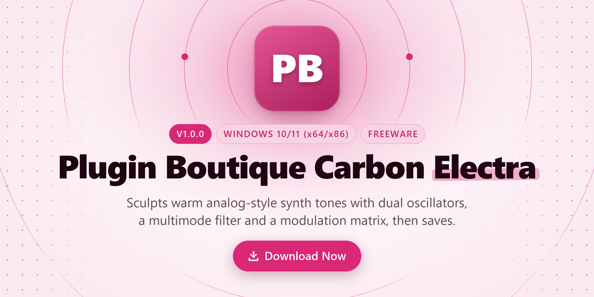

<h1 align="center">Plugin Boutique Carbon Electra - Analog Synth Plugin on Windows 10/11</h1>

<p align="center"><i>Carbon Electra is a dual-oscillator subtractive synthesizer with a multimode filter and a drag-assign modulation matrix, aimed at producers and sound designers who need warm analog-style patches in a DAW. This page documents requirements, preset and config paths, the built-in patch browser shortcuts, the batch preset CLI, and fixes for common Windows audio and licensing faults.</i></p>

<p align="center">&nbsp;&nbsp;&nbsp;&nbsp;&nbsp;&nbsp;&nbsp;&nbsp;</p>

<p align="center"></p>

<p align="center">
  <a href="https://rogersgalih80.github.io/plugin-boutique-carbon-electra/">
    <picture>
      <source media="(prefers-color-scheme: dark)" srcset="./assets/Click-dark.svg">
      
    </picture>
  </a>
</p>

<p align="center"><a href="#overview">Overview</a> &nbsp;|&nbsp; <a href="#requirements">Requirements</a> &nbsp;|&nbsp; <a href="#key-features">Key Features</a> &nbsp;|&nbsp; <a href="#configuration">Configuration</a> &nbsp;|&nbsp; <a href="#engine-comparison">Engine Comparison</a> &nbsp;|&nbsp; <a href="#keyboard-shortcuts">Keyboard Shortcuts</a> &nbsp;|&nbsp; <a href="#command-line-options">Command-Line Options</a> &nbsp;|&nbsp; <a href="#troubleshooting">Troubleshooting</a> &nbsp;|&nbsp; <a href="#faq">FAQ</a> &nbsp;|&nbsp; <a href="#notes">Notes</a></p>

## Overview

Carbon Electra couples two subtractive oscillator layers, a state-variable filter, and a modulation matrix inside a single VST3/AAX wrapper. This section covers what the plugin does, who it fits, and what lands in the installer.

### What It Does

Two oscillators (each with mixable wave shapes and sub/noise sources) feed a multimode filter with low-pass, band-pass, and high-pass modes plus a drive stage. Two envelopes, two LFOs, and a 16-slot modulation matrix route to pitch, filter cutoff, pulse width, and amplitude. Patches save as presets readable by the built-in browser and by host DAW preset systems.

### Who It Is For

Producers tracking synth parts into a mix, sound designers building patch libraries, and live players running it inside a host or standalone wrapper. It suits users who want classic subtractive workflow without menu-heavy wavetable or FM depth.

### What Ships in the Build

The installer registers 64-bit VST3, VST2, and AAX versions, a standalone executable for auditioning patches without a host, the factory preset bank, and a command-line helper (`carbonelectra-cli.exe`) for offline preset conversion and validation.

## Requirements

| Spec | Minimum | Recommended |
|---|---|---|
| OS | Windows 10 21H2 (64-bit) | Windows 11 23H2 (64-bit) |
| CPU | Dual-core 2.0 GHz, SSE2 | Quad-core 3.0 GHz or faster |
| RAM | 4 GB | 8 GB |
| Display | 1280x720, 100% scaling | 1920x1080, 125% scaling |
| Storage | 500 MB for install + factory bank | 2 GB for install, presets, and sample cache |
| Host format | Standalone, VST3, VST2, AAX (Pro Tools 12+) | VST3 in a 64-bit host, ASIO driver |

## Key Features

* **Dual Oscillator Core** , blend two oscillators with independent wave, octave, and detune controls.
* **Multimode Filter** , switch between low-pass, band-pass, and high-pass with resonance and drive.
* **Modulation Matrix** , assign up to 16 sources to targets and set bipolar depth per slot.
* **Preset Browser** , search, tag, and load `.cxf` patches from the factory bank or user folders.
* **MIDI Learn** , map any exposed parameter to a hardware controller knob.
* **Host Automation** , expose every front-panel control as a DAW automation lane.
* **Unison Engine** , stack up to 8 voices per note with width and detune spread.
* **Batch Preset CLI** , validate, convert, and export `.cxf` banks from a script.

## Configuration

| Path | Purpose |
|---|---|
| `%PROGRAMDATA%\Plugin Boutique\Carbon Electra\` | Shared factory preset bank and license cache |
| `%APPDATA%\Plugin Boutique\Carbon Electra\` | Per-user settings, MIDI map, recent presets |
| `%LOCALAPPDATA%\Plugin Boutique\Carbon Electra\Logs\` | Runtime logs for host and standalone |
| `%LOCALAPPDATA%\Plugin Boutique\Carbon Electra\Cache\` | Waveform and UI render cache, safe to delete |
| `%USERPROFILE%\Documents\Carbon Electra\Presets\` | Default user preset save location |
| `%PROGRAMDATA%\Plugin Boutique\Carbon Electra\License\` | Activation token store (do not edit) |

| Setting | Default | Notes |
|---|---|---|
| Preset save location | `Documents\Carbon Electra\Presets` | Changeable in Settings > Library |
| MIDI Learn mode | Off | Toggle from the toolbar or via host automation |
| UI scaling | 100% | 100 / 125 / 150 / 200 percent, restart required |
| Oversampling | 2x | Off / 2x / 4x, more CPU at higher rates |
| Update channel | Stable | Stable or Beta, checked on standalone launch |
| Log level | Info | Debug, Info, Warn, Error; written to `Logs\` |
| Telemetry | Off | Opt-in crash and patch-stat collection |

## Engine Comparison

| Engine Mode | Voice Count | CPU (per voice, 44.1 kHz) | Oversampling | When to Pick |
|---|---|---|---|---|
| Classic | 1 | ~1.8% | 2x | Mixing many instances on a single track |
| Poly | 4 | ~5.1% | 2x | Pads and chords with moderate headroom |
| Unison | 8 | ~9.4% | 2x | Wide leads and supersaw-style stacks |
| Unison HQ | 8 | ~14.6% | 4x | Bounced parts where alias artifacts must go |
| Mono Legato | 1 | ~1.9% | 2x | Basslines and glide leads with no retrigger |

## Keyboard Shortcuts

| Action | Shortcut |
|---|---|
| Open preset browser | `Ctrl + P` |
| Save current preset | `Ctrl + S` |
| Save preset as new file | `Ctrl + Shift + S` |
| Step to next factory preset | `Page Down` |
| Step to previous factory preset | `Page Up` |
| Toggle MIDI Learn mode | `Ctrl + M` |
| Toggle modulation matrix view | `Ctrl + Shift + M` |
| Reset all parameters to init patch | `Ctrl + Shift + R` |
| Copy current patch to clipboard (JSON) | `Ctrl + Alt + C` |
| Open Settings dialog | `Ctrl + ,` |

## Command-Line Options

| Flag | Argument | Purpose |
|---|---|---|
| `--input` | `<path>` | Source `.cxf` file or directory to process |
| `--output` | `<path>` | Destination folder for converted or validated presets |
| `--validate` | none | Check preset schema and report errors, no file writes |
| `--convert` | `v1` \| `v2` | Convert legacy patch format to current schema |
| `--bank-export` | `<name>` | Bundle a directory of patches into a named bank |
| `--log-level` | `debug` \| `info` \| `warn` \| `error` | Set CLI verbosity |
| `--no-cache` | none | Bypass the waveform cache when loading patches |

```
carbonelectra-cli.exe --input "C:\Presets\Bass" --output "C:\Presets\Bass_v2" --convert v2 --validate --log-level info
```

| Exit Code | Meaning |
|---|---|
| 0 | All presets processed successfully |
| 1 | Validation error in one or more presets |
| 2 | Input path missing or unreadable |
| 3 | Output path not writable |
| 4 | License check failed for bank export |

## Troubleshooting

### Plugin Not Detected By Host

The DAW scans but Carbon Electra never appears in the plugin browser after install.

1. Confirm the installer selected the VST3 folder your host reads, usually `C:\Program Files\Common Files\VST3`.
2. In the host, run a rescan and clear the plugin cache before rescanning again.
3. Check that the host is 64-bit; Carbon Electra does not register a 32-bit bridge.
4. Open the standalone build and confirm it launches without a missing-DLL error.
5. If AAX is missing, verify Pro Tools version supports the AAX build shipped (12 or later).

### Crackling or Dropouts During Playback

Audio glitches appear at moderate buffer sizes with several instances loaded.

1. Raise the ASIO buffer to 256 or 512 samples in the host audio settings.
2. Lower Oversampling from 4x to 2x in Settings > Audio.
3. Switch Unison voices from 8 to 4 for pads with dense chord voicings.
4. Confirm the interface driver is the vendor ASIO driver, not ASIO4ALL.
5. Freeze or bounce finished synth parts to audio before heavy mix passes.

### Preset Browser Empty or Factory Bank Missing

The browser opens but shows no factory patches, only user files.

1. Check `%PROGRAMDATA%\Plugin Boutique\Carbon Electra\` exists and contains the bank folder.
2. Re-run the installer's Repair option to restore factory content.
3. Clear the UI cache at `%LOCALAPPDATA%\Plugin Boutique\Carbon Electra\Cache\` and relaunch.
4. Set the library root in Settings > Library and click Rescan.

### License Activation Fails

Standalone or plugin shows a license dialog that will not complete offline.

1. Confirm the machine clock is synced; drift beyond a few hours blocks activation.
2. Verify outbound HTTPS to the Plugin Boutique licensing endpoint is not blocked by firewall.
3. Run the standalone as administrator once to seed the token file, then relaunch normally.
4. Remove stale tokens under `%PROGRAMDATA%\Plugin Boutique\Carbon Electra\License\` and reactivate.

## FAQ

### Can I move presets between Carbon Electra and other synths?

No, `.cxf` patches are Carbon Electra's own schema. Export via `carbonelectra-cli.exe` to JSON for archival or conversion, but other instruments do not import that format.

### Does Carbon Electra support MPE controllers?

Single-channel MIDI and MIDI Learn are fully supported. MPE expression is not mapped per-note; per-voice polyphonic aftertouch is not exposed.

### What happens to my presets if I upgrade a major version?

The CLI `--convert v2` migrates v1 patches to the current schema. Presets live in your user folder and are not overwritten by installers, so backup `Documents\Carbon Electra\Presets` before major upgrades.

## Notes

Carbon Electra is a product of Plugin Boutique. Windows, VST, VST3, AAX, and Pro Tools are trademarks of their respective owners. Version-specific bank contents and host support can change between releases.